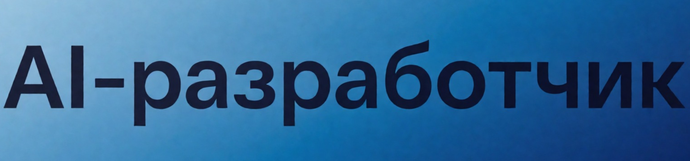

<!-- ✏️ Подсказки по правке:
     1. Замените «Селезнёв» на своё имя (или ник).
     2. В разделе «Контакты» впишите свой Telegram / email.
     3. Описания проектов можно поправить под себя. -->

  

### 🙋‍♂️ Обо мне

- 🔭 Сейчас работаю над Android-приложением **FocusField**
- 🌱 Изучаю **Laravel** и **React**, становлюсь fullstack-разработчиком
- 💬 Пишу на **PHP, JavaScript, Kotlin** — от вёрстки до бэкенда
- ⚡ Ценю в коде: чистоту, простоту и чтобы «работало с первого раза»

---

### 🛠️ Мой стек

**Frontend**

**Backend**

**Ещё**

---

### 📊 Моя статистика на GitHub

---

### 🚀 Мои проекты

| | Проект | Описание |
|---|---|---|
| 📱 | [**FocusField**](https://github.com/developerseleznevru-cmd/FocusField) | AI-менеджер внимания: Kotlin, MVVM, ML Kit, Wear OS — блокирует отвлекающие приложения |
| 🍽️ | [**restaurant**](https://github.com/developerseleznevru-cmd/restaurant) | Веб-приложение для ресторана: Laravel, Tailwind CSS, Vite |
| 🌿 | [**EcoTrack**](https://github.com/developerseleznevru-cmd/EcoTrack) | Android-приложение (Kotlin) для отслеживания «зелёных» привычек |

---

### 🐍 Змейка моих коммитов

<picture>
  <source media="(prefers-color-scheme: dark)" srcset="https://raw.githubusercontent.com/developerseleznevru-cmd/developerseleznevru-cmd/output/github-contribution-grid-snake-dark.svg" />
  <source media="(prefers-color-scheme: light)" srcset="https://raw.githubusercontent.com/developerseleznevru-cmd/developerseleznevru-cmd/output/github-contribution-grid-snake.svg" />
  
</picture>

---

### 📬 Контакты

